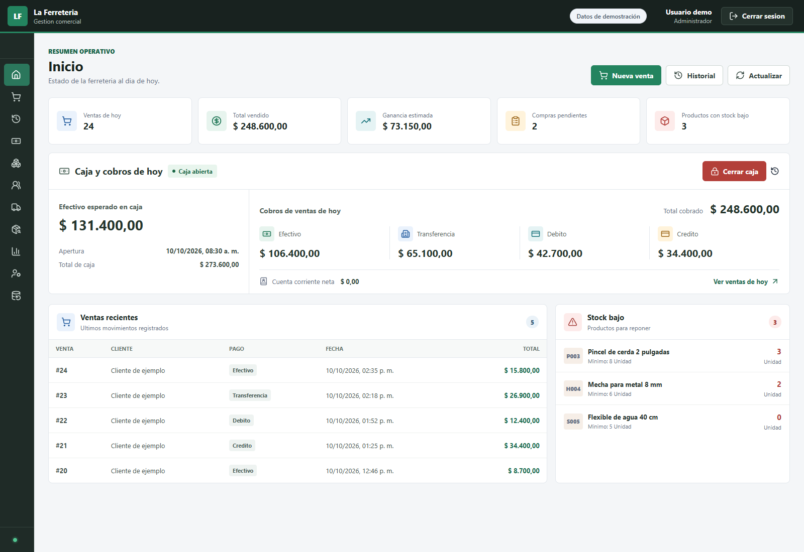
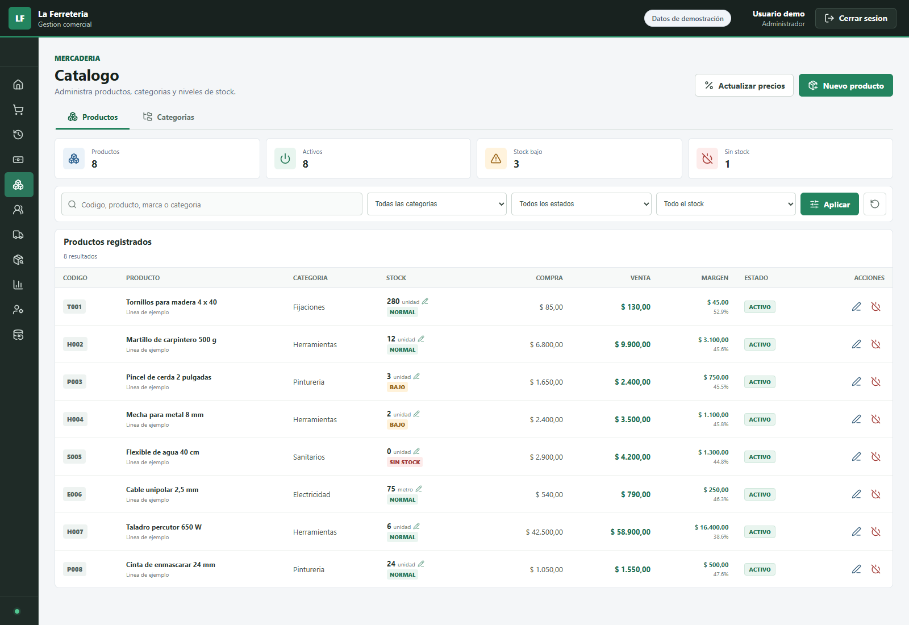
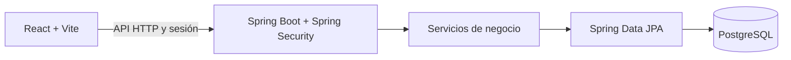

<div align="center">

# La Ferretería

### Gestión comercial en una sola aplicación

**React · Java 21 · Spring Boot · PostgreSQL**

Ventas · Inventario · Clientes · Compras · Caja · Reportes



<sub>Interfaz del proyecto con datos ficticios de demostración.</sub>

</div>

## El proyecto

La Ferretería es un sistema de gestión comercial que conecta las tareas diarias de un negocio: vender productos, consultar existencias, registrar compras, administrar clientes y controlar los movimientos de caja.

La interfaz está desarrollada en React y se comunica con una API en Spring Boot. La información se almacena en PostgreSQL, con autenticación y permisos para administradores y vendedores.

## Funcionalidades

| Módulo | Qué permite hacer |
| :--- | :--- |
| **Ventas** | Registrar ventas, consultar el historial, revisar detalles y emitir comprobantes |
| **Inventario** | Administrar productos y categorías, ajustar existencias y consultar movimientos de stock |
| **Clientes** | Gestionar clientes, cuentas corrientes y pagos |
| **Compras** | Administrar proveedores, cargar compras y consultar su estado |
| **Caja** | Apertura, movimientos, cierre y arqueo; configuración de cierre automático |
| **Reportes** | Consultar información de ventas, productos y caja |
| **Administración** | Gestionar usuarios, roles y copias de seguridad |

## Una mirada al catálogo



El catálogo reúne filtros, existencias, precios y márgenes para consultar la información del producto desde una misma pantalla.

## Arquitectura



El backend organiza controladores, servicios, repositorios y entidades. El frontend separa páginas, componentes, autenticación y acceso a la API. El proyecto también conserva plantillas Thymeleaf en el backend.

## Tecnologías

| Área | Implementación |
| :--- | :--- |
| Frontend | React 19, React Router 7, Vite 8 y Lucide React |
| Backend | Java 21, Spring Boot 4.1, Spring Security y Spring Data JPA |
| Persistencia | PostgreSQL; H2 para las pruebas que lo configuran |
| Construcción | Gradle Wrapper y pnpm 11.9 |
| Pruebas incluidas | JUnit/Spring Boot para backend y Node.js Test Runner para cantidades del frontend |

## Ejecutar localmente

Necesitás **Java 21**, **Node.js 24** y una instancia local de **PostgreSQL**. Gradle usa **pnpm 11.9** mediante npm; no hace falta instalarlo globalmente.

1. Creá una base vacía para demostración.
2. Configurá la conexión y el administrador inicial según [la guía de configuración](docs/CONFIGURACION.md).
3. Desde `backend`, ejecutá:

```powershell
.\gradlew.bat bootRun
```

En Linux o macOS podés usar `bash ./gradlew bootRun`.

Gradle instala y compila el frontend y lo incorpora al backend. Con el puerto predeterminado de esta copia, abrí **http://localhost:9092/app/**.

### Desarrollo del frontend

Con el backend en ejecución, desde `frontend`:

```powershell
npx --yes pnpm@11.9.0 install --frozen-lockfile
npx --yes pnpm@11.9.0 dev
```

Vite utiliza el puerto `5173` y redirige las llamadas `/api` al backend en `9092`.

## Comprobaciones disponibles

```powershell
# Desde frontend
npx --yes pnpm@11.9.0 lint
node --test src/utils/quantities.test.js

# Desde backend
.\gradlew.bat test
```

En la revisión de esta copia pasaron **10 pruebas del frontend y 113 del backend**, además del lint y la compilación. Se utilizó H2 en memoria y se excluyó una prueba que requiere PostgreSQL real. El [informe de verificación](docs/VERIFICACION.md) detalla el entorno y los límites de esa revisión.

## Estructura

```text
frontend/
├── src/pages/             # Pantallas del sistema
├── src/components/        # Componentes y formularios
├── src/auth/              # Sesión y autenticación
└── src/api/               # Comunicación con el backend
backend/
├── src/main/java/         # Controladores, servicios, entidades y repositorios
├── src/main/resources/    # Configuración y plantillas
└── src/test/              # Pruebas del backend
docs/
├── CONFIGURACION.md       # Preparación del entorno local
└── images/                # Capturas con datos de demostración
```

## Alcance de esta publicación

Esta copia está preparada para mostrar el código y la interfaz del proyecto. No incluye registros del negocio, copias de bases de datos, credenciales locales ni instaladores de uso interno. Se debe iniciar con una base propia y credenciales elegidas para ese entorno.

La impresión directa de tickets depende de la configuración y los controladores de la impresora en Windows. Las copias de seguridad requieren las herramientas de PostgreSQL.

---

Proyecto de [Benjamin Lagos](https://github.com/benjapato).
